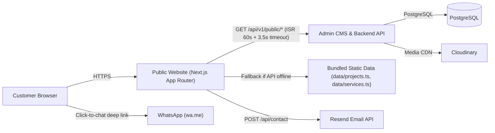
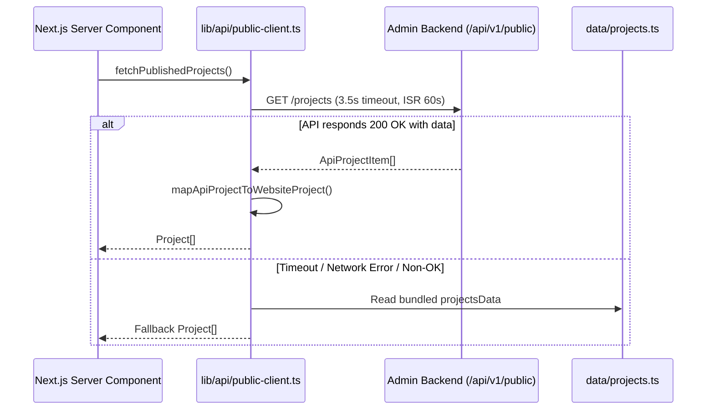

# MAMA INTERIOR — Public Website

The customer-facing web platform for **MAMA INTERIORS** (led by Master Contractor & Proprietor Ritesh Kumar Soni), a multi-trade residential and commercial interior contracting business operating in **Hyderabad, Telangana, and surrounding regions**.

Built with **Next.js 16 (App Router)**, **React 19**, **TypeScript**, and **Tailwind CSS v4**, the application presents core contracting disciplines, showcases verified on-site project photography and before/after transformations, and captures client enquiries through both **WhatsApp pre-filled deep links** and **transactional email delivery via Resend**.

---

## System Context & Repository Relationship

The MAMA INTERIOR platform is structured as two decoupled Next.js applications:

| Application | Intended Production URL | Repository / Directory | Responsibility |
| :--- | :--- | :--- | :--- |
| **Public Website** *(this repo)* | `https://mamainterior.in` | `website/` | Customer-facing portfolio, service pages, SEO metadata, enquiry capture, and ISR-cached API consumption |
| **Admin CMS & Backend API** | `https://admin.mamainterior.in` | [`../admin/README.md`](../admin/README.md) | Single-owner CMS dashboard, PostgreSQL persistence (Prisma), Cloudinary media pipeline, and `/api/v1/*` endpoints |

> **Deployment Status Note:** `https://mamainterior.in` and `https://admin.mamainterior.in` represent the intended production architecture. Live production deployment is not verified from this repository alone; `data/siteConfig.ts` currently sets `siteConfig.url` to `https://shancontractor.com` (legacy domain reference) and `lib/api/public-client.ts` defaults to `http://localhost:3001/api/v1/public` when `NEXT_PUBLIC_API_URL` / `API_URL` is unset.



---

## Key Features

### Implemented Features
- **Responsive Multi-Page Architecture:** Homepage (`/`), Services overview (`/services`), four dedicated trade pages (`/services/electrical`, `/services/carpentry`, `/services/painting`, `/services/ceiling`), filterable Portfolio (`/projects`), dynamic Project Detail pages (`/projects/[slug]`), About (`/about`), and Contact (`/contact`).
- **Four Core Contracting Disciplines:**
  - **Electrical Works:** Concealed wiring, distribution boards, architectural lighting, and fittings.
  - **Carpentry & Woodwork:** Custom modular kitchens, wardrobes, TV units, and joinery.
  - **Painting & Finishes:** Interior/exterior coatings, royal textures, and waterproofing.
  - **Ceiling Solutions:** Gypsum false ceilings, POP work, cove lighting, and acoustic layouts.
- **Interactive Portfolio & Transformations:**
  - Client-side category filtering (`ProjectsGalleryView` + `CategoryFilter`) with live per-trade project counts.
  - Project detail pages featuring a multi-image gallery (`MediaGallery`), on-site video playback (`VideoCard`), and an interactive **Before/After comparison slider** (`BeforeAfterSlider`) supporting pointer drag, touch, keyboard navigation (`ArrowLeft`, `ArrowRight`, `Home`, `End`), and full-screen lightbox mode, plus `BeforeAfterVideo`.
- **Dual-Channel Lead Capture (`EnquiryForm`):**
  - **WhatsApp Direct Flow:** Compiles client name, phone, selected trade, location, and scope into a URL-encoded `wa.me` message via `buildWhatsAppUrl`.
  - **Server-Side Email Flow (`POST /api/contact`):** Validates inputs, checks a hidden anti-bot honeypot field, escapes HTML entities, and dispatches a formatted HTML lead email through the **Resend** SDK.
- **Resilient CMS Integration (`lib/api/public-client.ts`):**
  - Fetches published projects, curated homepage projects, and public settings from the Admin CMS API with a **3.5-second `AbortController` timeout** and Next.js cache tags (`projects`, `project-<slug>`, `homepage`, `services`, `settings`).
  - Automatically falls back to bundled data (`data/projects.ts`, `data/services.ts`) if the backend API is offline or unreachable.
- **On-Demand Cache Revalidation (`POST /api/revalidate`):** Secret-authenticated endpoint (`x-revalidation-secret` header or `?secret=` query parameter) calling `revalidateTag` and `revalidatePath`.
- **SEO & Structured Data:** Root `Metadata` with Open Graph and Twitter cards, `HomeAndConstructionBusiness` JSON-LD schema (`app/layout.tsx`), dynamic `sitemap.xml` (`app/sitemap.ts`), and `robots.txt` (`app/robots.ts`).

### Partial / Pending Items
- **Dynamic Services & Settings Rendering:** `fetchPublicServices()` currently returns bundled `servicesData` even when `/api/v1/public/services` responds `200 OK`, and `Home` / `SiteHeader` / `SiteFooter` read business info from `data/siteConfig.ts` rather than consuming `fetchPublicSettings()`.
- **Environment-Driven Contact & Site URL:** `.env.example` defines `NEXT_PUBLIC_SITE_URL`, `NEXT_PUBLIC_WHATSAPP_NUMBER`, and `NEXT_PUBLIC_PHONE_NUMBER`, but `data/siteConfig.ts` currently stores these values directly in TypeScript constants.
- **Automatic Revalidation Trigger:** `/api/revalidate` is implemented on the website, but the Admin CMS does not yet automatically invoke it upon publishing or updating content.

---

## Technology Stack

| Category | Technology | Version (from `package.json`) | Role in Project |
| :--- | :--- | :--- | :--- |
| **Framework** | Next.js (App Router + Turbopack) | `16.4.5` | Server Components, Route Handlers (`/api/*`), ISR caching, metadata/sitemap generation |
| **UI Runtime** | React / React DOM | `19.3.0` | Component rendering and client interactivity |
| **Language** | TypeScript (`strict: true`) | `^5` | End-to-end type safety across pages, API mappers, and data models |
| **Styling** | Tailwind CSS + `@tailwindcss/turbopack` | `^4` | Utility-first styling with `@theme` design tokens in `app/globals.css` |
| **Typography** | `Manrope` & `Inter` (`next/font/google`) | Built-in | Self-hosted Google Fonts with `display: "swap"` and CSS variables |
| **Icons** | `lucide-react` | `^1.70.0` | Consistent vector iconography across navigation, services, and forms |
| **Email Delivery** | `resend` | `^6.38.1` | Transactional HTML lead notifications from `/api/contact` |
| **Linting** | ESLint + `eslint-config-next` | `^9` / `16.4.5` | Static code quality and Next.js rule enforcement |

> **Note:** No third-party animation library (such as Framer Motion) is installed. Transitions use native CSS/Tailwind utilities with `@media (prefers-reduced-motion: reduce)` support, and interactive media controls use native DOM Pointer Events.

---

## Architecture & Project Structure

### Data Flow
1. **Server Components** (`app/page.tsx`, `app/projects/page.tsx`, `app/projects/[slug]/page.tsx`, `app/sitemap.ts`) call functions in `lib/api/public-client.ts`.
2. `public-client.ts` queries the Admin CMS public endpoints (`/api/v1/public/homepage`, `/api/v1/public/projects`, `/api/v1/public/projects/[slug]`) with `revalidate: 60` and cache tags.
3. `mapApiProjectToWebsiteProject()` normalizes backend `ApiProjectItem` payloads into the frontend `Project` interface, pairing `BEFORE` and `AFTER` media roles into `BeforeAfterPair[]` and filtering raw `BEFORE` photos out of the finished-work gallery.
4. If the API is unavailable or times out (3.5s), `public-client.ts` transparently falls back to `data/projects.ts` so customer-facing pages remain operational.



### Directory Tree

```text
website/
├── app/
│   ├── about/page.tsx                # Contractor philosophy & craftsmanship standards
│   ├── api/
│   │   ├── contact/route.ts          # POST lead form -> Resend email with honeypot & HTML escaping
│   │   └── revalidate/route.ts       # POST secret-protected on-demand ISR cache invalidation
│   ├── contact/page.tsx              # Enquiry form & direct contact channels
│   ├── projects/
│   │   ├── page.tsx                  # Filterable completed projects gallery
│   │   └── [slug]/page.tsx           # Dynamic project detail, gallery, video & before/after slider
│   ├── services/
│   │   ├── page.tsx                  # Services overview
│   │   ├── carpentry/page.tsx        # Carpentry & woodwork detail page
│   │   ├── ceiling/page.tsx          # False ceiling & POP detail page
│   │   ├── electrical/page.tsx       # Electrical works detail page
│   │   └── painting/page.tsx         # Painting & finishes detail page
│   ├── globals.css                   # Tailwind v4 @theme tokens, focus ring, reduced-motion rules
│   ├── layout.tsx                    # Root layout, Google Fonts, Metadata, JSON-LD LocalBusiness
│   ├── not-found.tsx                 # Custom 404 page
│   ├── page.tsx                      # Homepage
│   ├── robots.ts                     # Dynamic robots.txt
│   └── sitemap.ts                    # Dynamic sitemap.xml (static + service + project routes)
├── components/
│   ├── forms/EnquiryForm.tsx         # Client-side validation, WhatsApp & /api/contact submission
│   ├── layout/                       # SiteHeader, SiteFooter, MobileNavigation
│   ├── projects/                     # BeforeAfterSlider, BeforeAfterVideo, CategoryFilter, MediaGallery,
│   │                                 # PortfolioProjectCard, ProjectCard, ProjectsGalleryView,
│   │                                 # TransformationSection, VideoCard
│   ├── sections/                     # HeroSection, HomeCTA, PortfolioSection, ProcessSection,
│   │                                 # ProcessStep, TrustStrip, WhyChooseUs
│   ├── services/                     # ServiceCard, ServiceDetailTemplate, ServicesGrid
│   └── ui/                           # Button, Container, PageHero, SectionHeading
├── data/
│   ├── projects.ts                   # Bundled fallback portfolio projects
│   ├── services.ts                   # Structured trade definitions & specifications
│   └── siteConfig.ts                 # Business identity, contact facts, navigation links
├── lib/
│   ├── api/public-client.ts          # Typed API client, schema mapper & offline fallback logic
│   └── whatsapp.ts                   # WhatsApp wa.me & tel: URL builders
├── public/
│   ├── branding/                     # Favicons, Apple touch icon, SVG/PNG logos
│   ├── images/                       # Local fallback photography organized by trade
│   └── videos/                       # Hero background video (hero-bg.mp4)
├── types/                            # navigation.ts, project.ts, service.ts
├── next.config.ts                    # Cloudinary remotePatterns & Turbopack CSS loader config
├── package.json
└── tsconfig.json
```

---

## UI/UX Engineering

- **Design Tokens (`app/globals.css`):** Centralized color and radius tokens via Tailwind v4 `@theme` (`#F7F5F0` warm base, `#FFFFFF` surface, `#172B40` primary navy, `#B58A58` warm brass accent, `#21865B` success, `#B42318` error) paired with `Manrope` headings and `Inter` body text.
- **Reusable Component Primitives:** `Container`, `PageHero`, `SectionHeading`, `Button` (supporting `primary`, `outline`, `accent`, `whatsapp` variants), and `ServiceDetailTemplate` enforce visual consistency across all trade and portfolio pages.
- **Interactive Before/After Comparison (`BeforeAfterSlider.tsx`):** Uses Pointer Capture (`setPointerCapture` / `releasePointerCapture`) for smooth drag scrubbing on mouse and touch, `touch-none` to prevent scroll hijacking, `role="slider"` with ARIA value attributes, keyboard arrow controls, and an Escape-dismissible lightbox.
- **Accessibility:** Global `:focus-visible` outline (`2px solid #B58A58`) and `@media (prefers-reduced-motion: reduce)` reset in `app/globals.css`.
- **Form UX & Error States (`EnquiryForm.tsx`):** Field-level validation (name, 10-digit phone, 10+ char description), loading state during `/api/contact` submission, clear error banners, and WhatsApp fallback if email delivery is unavailable (`503`).

---

## SEO & Performance

### Implemented Practices
- **Metadata & Open Graph:** Configured in `app/layout.tsx` (`metadataBase`, title template, Open Graph `en_IN`, Twitter `summary_large_image`) and overridden per project in `app/projects/[slug]/page.tsx` via `generateMetadata()`.
- **Structured Data:** `HomeAndConstructionBusiness` JSON-LD in `app/layout.tsx` including proprietor, Hyderabad address, service area, working hours, and `OfferCatalog`.
- **Crawlability:** `app/sitemap.ts` dynamically enumerates static routes, service pages, and published project slugs; `app/robots.ts` allows indexing and references `/sitemap.xml`.
- **Image & Font Optimization:** `next/image` with `sizes` attributes, `priority` on hero/primary slider images, Cloudinary `remotePatterns` in `next.config.ts`, and `next/font/google` (`Manrope`, `Inter`) with `display: "swap"`.
- **Caching Strategy:** `fetch()` calls in `lib/api/public-client.ts` use Next.js `revalidate: 60` and cache tags, paired with `generateStaticParams()` on `/projects/[slug]` and `/api/revalidate` for on-demand invalidation.

---

## Environment Configuration & Local Setup

### Environment Variables

| Variable | Required | Used In | Purpose |
| :--- | :--- | :--- | :--- |
| `NEXT_PUBLIC_API_URL` | Optional | `lib/api/public-client.ts` | Public API base URL (defaults to `http://localhost:3001/api/v1/public`) |
| `API_URL` | Optional | `lib/api/public-client.ts` | Server-side fallback API base URL if `NEXT_PUBLIC_API_URL` is unset |
| `RESEND_API_KEY` | For email form | `app/api/contact/route.ts` | Resend API key for `/api/contact` email delivery |
| `CONTACT_NOTIFICATION_EMAIL` | Optional | `app/api/contact/route.ts` | Primary recipient email for lead notifications |
| `CONTACT_EMAIL_RECIPIENT` | Optional | `app/api/contact/route.ts` | Secondary fallback recipient email variable |
| `REVALIDATION_SECRET` | For webhook | `app/api/revalidate/route.ts` | Shared secret required to authorize `POST /api/revalidate` |

> **Safe `.env.local` Template:**
> ```env
> # Backend Public API (Admin CMS)
> NEXT_PUBLIC_API_URL=http://localhost:3001/api/v1/public
>
> # Lead Form Email Delivery (Resend)
> RESEND_API_KEY=re_xxxxxxxxxxxxxxxxxxxxxxxxx
> CONTACT_NOTIFICATION_EMAIL=owner@example.com
>
> # On-Demand ISR Revalidation
> REVALIDATION_SECRET=replace-with-shared-secret
> ```

### Local Development Commands

```bash
# 1. Install dependencies
cd website
npm install

# 2. Configure environment
cp .env.example .env.local   # Edit with your local values

# 3. Start development server (http://localhost:3000)
npm run dev

# 4. Type-check, lint, and build
npx tsc --noEmit
npm run lint
npm run build

# 5. Start production server locally
npm run start
```

---

## Engineering Decisions & Trade-offs

- **Graceful Offline Fallback over Hard API Dependency:** `lib/api/public-client.ts` enforces a 3.5-second timeout and falls back to `data/projects.ts` on failure. *Trade-off:* Guarantees the public site never renders a 500 error if the CMS backend is down or unseeded, at the cost of temporarily serving bundled portfolio items until the API recovers.
- **Decoupled Media Transformation (`mapApiProjectToWebsiteProject`):** The API client transforms backend `ProjectMedia` roles (`BEFORE`, `AFTER`, `COVER`, `GALLERY`) into UI-specific structures (`BeforeAfterPair[]`), keeping raw demolition photos out of the finished gallery.
- **Dual Lead-Capture Strategy:** Combining instant WhatsApp deep links (low friction for Indian residential/commercial clients) with a server-side Resend form (structured lead capture with honeypot and HTML escaping) maximizes conversion without requiring a database on the public website.
- **Zero-Secret Public Frontend:** The public website holds no database connection string or Cloudinary API secret, minimizing its attack surface.

---

## Technical Highlights

- **Next.js 16 App Router + ISR Tagging:** Tag-based caching (`projects`, `project-<slug>`, `homepage`, `services`, `settings`) with a dedicated `/api/revalidate` endpoint.
- **Accessible Custom Comparison Slider:** Pointer-capture drag, keyboard navigation, ARIA slider semantics, and lightbox support built without external UI dependencies.
- **Typed Backend-to-Frontend Adapter:** Clean separation between backend API schemas (`ApiProjectItem`) and frontend domain types (`Project`).

## Key Engineering Learnings

- Designing resilient frontend data-fetching layers with bounded timeouts and static fallbacks.
- Implementing accessible, cross-device pointer interactions (`PointerEvent` + `setPointerCapture`) in React.
- Structuring SEO metadata, `sitemap.ts`, `robots.ts`, and `HomeAndConstructionBusiness` JSON-LD in Next.js App Router.
- Securing public API routes (`/api/contact`, `/api/revalidate`) with input validation, HTML escaping, honeypot fields, and shared-secret verification.

---

## Future Improvements

- Wire `NEXT_PUBLIC_SITE_URL`, `NEXT_PUBLIC_WHATSAPP_NUMBER`, and `NEXT_PUBLIC_PHONE_NUMBER` into `data/siteConfig.ts` and update `siteConfig.url` to `https://mamainterior.in`.
- Connect `fetchPublicServices()` and `fetchPublicSettings()` to render CMS-managed services and business settings dynamically instead of static `servicesData` / `siteConfig`.
- Trigger `POST /api/revalidate` automatically from the Admin CMS when projects, homepage curation, or settings are published.
- Add automated unit and end-to-end tests (e.g., Playwright/Vitest) for `mapApiProjectToWebsiteProject`, `EnquiryForm`, and `/api/contact`.
